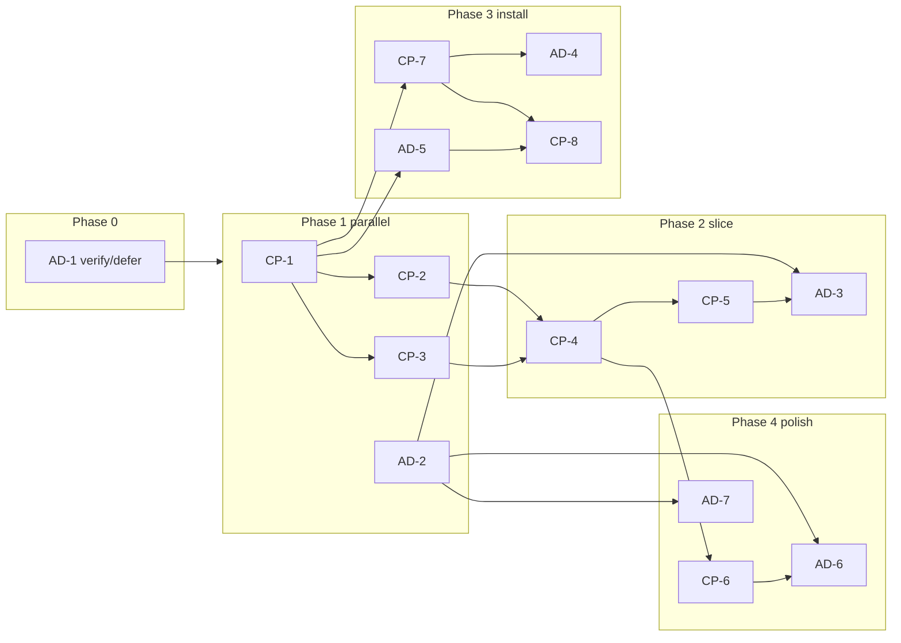

# Ember Discord — build phases and PR plan

**Normative behavior:** [SPEC.md](./SPEC.md)  
**Per-PR agent briefs:** [docs/pr/README.md](./pr/README.md) (one file per PR — **give that file to each agent**)

**Status (2026-10-28):** Phase 0 + **AD-1** merged. All other PRs **open**.

---

## How to run multiple agents

1. Pick PRs whose **Depends on** rows are already **merged** (see [pr/README.md](./pr/README.md)).
2. Assign **exactly one PR** per agent. Branch name and repo are in the PR brief.
3. Agent reads **`docs/pr/{ID}.md`** + relevant **SPEC.md** sections cited there.
4. Agent opens PR with title from brief; links `docs/pr/{ID}.md` in description.
5. When merged, update **Status** in `docs/pr/README.md` to `merged`.

### Standard agent spawn text

```text
Implement Ember Discord PR {ID} only.

Read (in order):
1. ember-discord-adapter/docs/pr/{ID}.md — full scope and acceptance checklist
2. ember-discord-adapter/docs/SPEC.md — sections cited in that brief

Repo: {see brief — secret-probation OR ember-discord-adapter}
Branch from: main (CP + adapter) or master (Voxen)
Create branch: {from brief}

Rules:
- One PR = one brief. No scope creep.
- No bot token on control plane. Internal routes: service bearer only.
- Amend docs/SPEC.md in adapter repo if behavior changes.
- All tests in brief must pass before review.

Do not merge other PRs’ work into this branch.
```

### Host labels (operator commands)

| Host | Path | Remote |
|------|------|--------|
| BenSpark | `~/secret-probation` | `Secret-Probation/Bens-control-plane` · branch **`main`** |
| BenSpark | `~/voxen` | `Secret-Probation/Voxen` · branch **`master`** |
| BenSpark | `~/ember-discord-adapter` | `Secret-Probation/ember-discord-adapter` · branch **`main`** |

Do **not** implement CP Discord routes on Spark2 or in Voxen workers.

---

## Phase map



---

## PR index (detail in `docs/pr/`)

| Phase | IDs | Goal |
|-------|-----|------|
| 0 | AD-1, V-1 | Repo, spec, adapter skeleton; Voxen pointers pushed |
| 1 | CP-1, CP-2, CP-3, AD-2 | Schema, router, cap, webhook formatter |
| 2 | CP-4, CP-5, AD-3 | Fan-query + poll + adapter loop |
| 3 | CP-7, AD-4, AD-5, CP-8 | Install, OAuth, UI |
| 4 | CP-6, AD-6, AD-7, CP-8b | Rollups, post-to-channel, deploy |
| 5 | Ops | Legal, Discord portal, `.206`, SWTS pilot (not single PR) |

---

## Merge gates

| Gate | Requires merged | Proof |
|------|-----------------|--------|
| **G1** | CP-1 | Migration + bearer tests green |
| **G2** | CP-1..5, AD-2, AD-3 | `/ember search` + ask in test guild (staging) |
| **G3** | CP-7, CP-8, AD-4, AD-5 | Owner connect + confirm + `/ember about` |
| **G4** | All through AD-7, CP-6 | Post-to-channel + smoke script on `.206` |
| **Pilot** | G3 + G4 + Phase 5 ops | SWTS design partner |

---

## Critical path

```text
CP-1 → CP-2 ─┐
CP-1 → CP-3 ─┼→ CP-4 → CP-5 → AD-3
               └→ (AD-2 in parallel from start)

CP-1 → CP-7 → AD-4
CP-1 → AD-5 → CP-8

CP-4 → CP-6 → AD-6
AD-2 → AD-7
```

**Max parallel agents (steady state): 3** — e.g. after CP-1: **CP-2** + **CP-3** + **AD-2**.

---

## Global PR rules

1. **Spec:** behavior change → update `docs/SPEC.md` in **ember-discord-adapter** (same PR or prior spec PR).
2. **Credentials:** `EMBER_DISCORD_SERVICE_BEARER` (adapter→CP); `EMBER_DISCORD_ADAPTER_INTERNAL_TOKEN` (CP→adapter). Never commit values.
3. **Internal API:** not on public vhost; document in CP PR if nginx/docker touched.
4. **Titles:** `feat(discord-cp): …` or `feat(discord): …`.
5. **Completion:** mark PR merged in [pr/README.md](./pr/README.md).

---

## Phase 5 — Pilot (ops checklist)

| Step | Owner |
|------|--------|
| Privacy, terms, deletion, report URLs | Legal |
| Discord app + interactions URL + OAuth redirect | Ops |
| `register` once after deploy | Ops |
| `.206` adapter + CP env | Ops |
| SWTS guild + hybrid QA | Human |

See SPEC §16, §20, §22.
